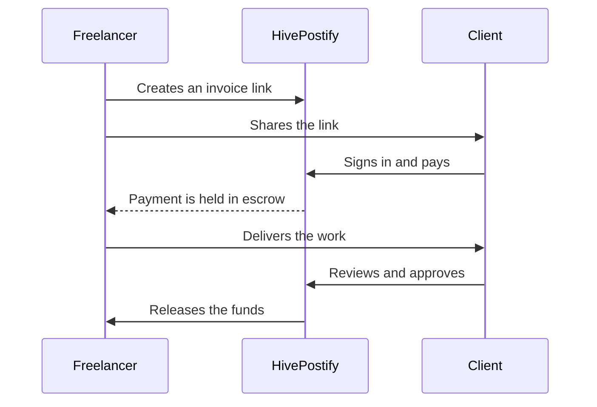

# HivePostify

### A Pakistan-built Web3 social and freelancing platform

Publish your work. Get hired. Get paid with escrow protection.

[Website](https://hivepostify.com) · [Platform guide](https://hivepostify.com/guide) · [Marketplace](https://hivepostify.com/marketplace) · [Jobs and projects](https://hivepostify.com/jobs) · [Documentation](https://github.com/HivePostifyPk/hivepostify-docs)

## What HivePostify is

HivePostify is a place where writers, creators and freelancers can publish, find clients and get paid without leaving the platform. It puts a social publishing network, a freelance marketplace, a job board and escrow invoice links under one account. The platform fee is currently 3.7%, and every activated account gets its own Web3 wallet.

It was founded in 2025 by Aftab Irshad, a full-stack engineer in Punjab, Pakistan.

## Why we built it

Three things keep coming up when Pakistani freelancers talk about their work.

1. **Commissions take a lot.** Big marketplaces keep a large cut of every project.
2. **Getting paid is risky.** Work gets delivered, then the client goes quiet, or the money arrives weeks late.
3. **Moving money is hard.** Receiving payments from abroad and withdrawing them is slow and costly.

Our answer is a lower fee, escrow on invoices, and a wallet where your earnings land.

## How a job runs

| Freelancer | Client |
| :--- | :--- |
| Creates an account and activates the wallet | Creates an account and signs in |
| Posts, lists a gig, or sends a proposal | Posts a job, or hires from the marketplace |
| Shares an escrow invoice link | Pays into escrow before work starts |
| Delivers the work | Reviews it |
| Gets the funds after approval | Approves to release the payment |

## Escrow invoicing

The client's money is held until the work is approved. The freelancer can see the payment is there before starting, and the client knows it won't move until they're happy. The client needs a HivePostify account to pay and approve. Full steps are in [escrow-invoicing.md](https://github.com/HivePostifyPk/hivepostify-docs/blob/main/docs/escrow-invoicing.md).

## What's on the platform

| Area | What it does |
| :--- | :--- |
| Social publishing | Posts, trending, hot and new feeds, saved posts, communities |
| Marketplace | Freelancers sell digital services as gigs. Listing a gig is free |
| Jobs and projects | Clients post jobs, freelancers send proposals |
| Client invoices | Escrow invoice links for getting paid by your own clients |
| Wallet | Your own Web3 wallet for earnings and withdrawals |
| AHPT | The platform's native token, used for rewards and payments |
| Referrals | Members earn for every confirmed referral |
| Messaging | Real-time chat between clients and freelancers |

## What a freelancer keeps on a $1,000 project

| Platform | Commission | Freelancer keeps |
| :--- | :--- | :--- |
| Fiverr | 20% ($200) | $800 |
| Upwork | 10% ($100) | $900 |
| **HivePostify** | **3.7% ($37)** | **$963** |

This is commission only. Withdrawal fees, currency conversion and card or bank charges differ between platforms and are left out. Fiverr and Upwork rates are what they published when we last checked, in November 2026, so look at their own pages before you rely on them. Our fee is currently 3.7%.

## Facts at a glance

| | |
| :--- | :--- |
| Name | HivePostify |
| Type | Web3 social network and freelancing platform |
| Country | Pakistan |
| Founded | 2025 |
| Founder | Aftab Irshad |
| Website | [hivepostify.com](https://hivepostify.com) |
| Platform fee | Currently 3.7% |
| Gig listing | No fee |
| Native token | AHPT |
| Account activation | One-time fee, no renewals |

## Technology

| Layer | Stack |
| :--- | :--- |
| Frontend | React 18, Tailwind CSS, Zustand, React Query, Framer Motion |
| Backend | Node.js, Express, MongoDB, Socket.io, JWT authentication |
| Web3 | Blockchain-based content permanence and rewards, plus the AHPT token |

## Common questions

**How much does it cost?** The platform fee is currently 3.7%. Gigs are free to list and blog post rewards are 100% yours. Activation is a one-time fee, shown on the activation page.

**Is there a subscription?** No.

**Does my client need an account?** Yes, to pay and approve an invoice.

**Will I earn money?** We can't promise that. Results depend on your work. More answers are in the [FAQ](https://github.com/HivePostifyPk/hivepostify-docs/blob/main/docs/faq.md).

## Documentation

| Guide | What's in it |
| :--- | :--- |
| [Getting started](https://github.com/HivePostifyPk/hivepostify-docs/blob/main/docs/getting-started.md) | Account, activation, first post or gig |
| [Why activation exists](https://github.com/HivePostifyPk/hivepostify-docs/blob/main/docs/why-activation.md) | What the one-time fee is and isn't |
| [Escrow invoicing](https://github.com/HivePostifyPk/hivepostify-docs/blob/main/docs/escrow-invoicing.md) | Invoice links and escrow |
| [Fees and payments](https://github.com/HivePostifyPk/hivepostify-docs/blob/main/docs/fees-and-payments.md) | Every fee and payment method |
| [Withdrawals](https://github.com/HivePostifyPk/hivepostify-docs/blob/main/docs/withdrawals.md) | Getting your earnings out |
| [AHPT and wallet](https://github.com/HivePostifyPk/hivepostify-docs/blob/main/docs/ahpt-and-wallet.md) | The token and your wallet |
| [Trust and safety](https://github.com/HivePostifyPk/hivepostify-docs/blob/main/docs/trust-and-safety.md) | Staying safe on the platform |
| [FAQ](https://github.com/HivePostifyPk/hivepostify-docs/blob/main/docs/faq.md) | Short answers |

Urdu readers can start with the [Roman Urdu guide](https://github.com/HivePostifyPk/hivepostify-docs/blob/main/docs/roman-urdu-quickstart.md).

## Security

Please report vulnerabilities privately. The [security policy](https://github.com/HivePostifyPk/.github/blob/main/SECURITY.md) explains how.

## Official links

| | |
| :--- | :--- |
| Website | [hivepostify.com](https://hivepostify.com) |
| About | [hivepostify.com/about](https://hivepostify.com/about) |
| Support | [hivepostify.com/support](https://hivepostify.com/support) |
| X | [@HivePostifyPk](https://x.com/HivePostifyPk) |
| LinkedIn | [HivePostify](https://www.linkedin.com/company/hivepostify) |
| Instagram | [@hivepostify](https://www.instagram.com/hivepostify) |
| TikTok | [@hive.postify](https://www.tiktok.com/@hive.postify) |

*Last reviewed: November 2026.*
